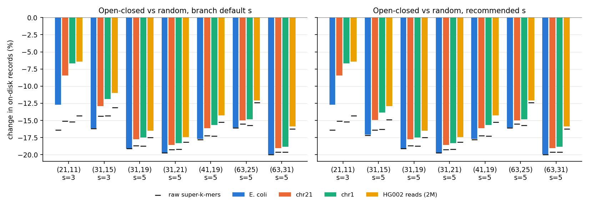
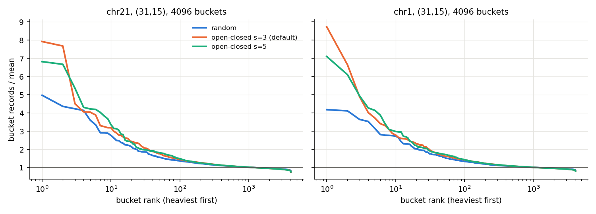

# Phase-3 benchmark: open-closed minimizers in sklib

| | |
|---|---|
| Spec | `PLAN-minimizer-scheme-option.md` §5 (validation and benchmark) |
| Branch under test | `feat/open-closed-minimizer` @ `eac061c`, in worktree `.claude/worktrees/feat-open-closed`. Not modified |
| Baseline binary | `main` @ `0f8badb`, built from `git archive` in a scratch directory |
| Builds | Release, clang++-18, LTO, `-march=native`, `WITH_TESTS=OFF`. Same flags for both |
| Machine | Intel Core Ultra 7 165H laptop, 60 GB RAM, NVMe. Date: 2026-10-12 |
| Raw results | `csv/`, `logs/`, `scripts/` next to this file on the run laptop; not in the repository. Only this report and `plots/` are committed |
| Compute used | about 2 h |

Notation: m = minimizer length, w = k − m + 1, s = s-mer length of the open-closed (OC) class.
"Records" are the on-disk virtual super-k-mers. "Raw" counts the super-k-mers emitted by the
Skmerator, before dedup and re-compaction. Every Δ is open-closed vs random. A negative Δ means
open-closed is smaller or faster.

---

## 0. Verdict

1. **Correctness: all 162 checks pass.** On real data, the random and open-closed indexes answer
   identically for every k-mer, give the same set sizes, and are byte-identical at `-t 1` and `-t 6`
   for construct, query and setop (§2).
2. **Size.** Open-closed is smaller everywhere measured.
   - At the branch's default s:
     - (31,15): −16.1 % records on E. coli, −12.9 % on chr21, −11.9 % on chr1, −11.0 % on the HG002 reads, −9.4 % on chm13;
     - (63,31): −20.0 % on E. coli, −19.1 % on chr21, −18.8 % on chr1, −15.9 % on the reads, −18.4 % on chm13.
   - Bits per k-mer at (31,15) on chr1: 18.20 → 16.05.
   - The gain is small at m ≤ 13 on human data: (21,11) −6.4 to −8.5 %. Re-compaction cancels half of the density gain there (§3).
   - The same happens at (31,15) on the whole genome. The raw gain on chm13 is −14.2 %, as on chr1, but records/raw grows 1.109 → 1.172, so only −9.4 % is left (−11.4 % with s=5). At (63,31), chm13 behaves like chr1.
3. **s = 3 is the wrong default at m = 15–17.** On every dataset, s = 5 gives 1–3 points more
   (chr21 (31,15): −14.9 % instead of −12.9 %; chr1: −13.9 % instead of −11.9 %) and a better
   bucket balance. Proposed s rule (§4):
   - odd m: s = 3 if m ≤ 13, else s = 5;
   - even m: s = 4 if m ≤ 16, else s = 6. Even-m default s = 4 is right up to m = 16, but at m ≥ 20, s = 6 gains 1.8–3 points.
4. **The chr21 shortfall** (−12.9 % vs about −16 % on E. coli and on uniform random sequence) has two halves (§6):
   - **Sequence composition:** about 1.6 points. Only 32 canonical 3-mers exist, so the 3-mer key
     order is sensitive to human k-mer statistics. An order-5 Markov chain trained on chr21 already
     loses 1.3 points. At the raw level, unique and repeat regions gain the same (−14.5 % vs −14.2 %).
   - **Repeats:** about 1.5 points, through dedup and re-compaction, not through density. A
     repeat-only index loses 2.1 points between raw and records; a unique-only index loses 0.4.
   - With s = 5 the composition part almost disappears and only the repeat part remains.
5. **Bucket balance is worse on human data**, except at (63,25), where open-closed is *better*
   (max/mean 19.8 → 7.2 on chr1).
   - The heaviest bucket grows 1.5–2.5× (chr1 (31,15): max/mean 4.2 → 8.7), and the CV grows 30–100 %.
   - Two mechanisms (§5–6):
     - **Low-complexity m-mers are open far too often.** P(open) ≈ 1/(number of distinct canonical s-mers in the m-mer). Homopolymers are always open. Hence the poly-A and STR buckets, up to 16× the mean at (32,16) s=6 and (35,17).
     - **Open Alu consensus m-mers** collect their family's super-k-mers, and re-compaction then *fragments* them. The poly-A junction `TCAAAAAAAAAAAAA` goes from 3 186 raw super-k-mers to 6 140 records, vs 905 records under random.
   - Practical impact today is small:
     - construct RAM is unchanged;
     - query RAM is −6 to −18 %;
     - set-op RAM is +15–35 %, but stays ≤ 57 MB on chr1;
     - one query case is slower: chr21 at (63,31), +10–17 % (§8).
6. **Time.** All measured with the same binary.
   - Construct: +2.0–2.8 % at (31,15), −1 to −2 % at (63,31) (t=1); within ±3 % at t=6.
   - Branch random path vs `main`: −0.5 to +0.8 % on construct and 0 to +1.1 % on the producer alone, within noise. No systematic overhead.
   - The open-closed class stream costs +8 to +26 % of the producer alone. That dilutes to the construct figures above.
   - Query: negative queries are 4–11 % faster; positive queries are within ±2 %, except chr21 (63,31).
   - Set ops: 4–8 % faster at t=1, −2 to +10 % at t=6 (runs under 2 s).
7. **Mitigation found (prototype, not on the branch).** Define the class with the **first and last
   argmin** ("extreme": open if either extreme occurrence of the minimal key is the central s-mer)
   instead of "attains the minimum".
   - It is still strand-symmetric, local and injective, and it passed the per-k-mer differential everywhere.
   - It demotes homopolymers and most STRs.
   - It removes the low-complexity hot buckets: chr21 (32,16) s=6, 16.5× → 5.9×; (35,17), 15.2× → 7.2×; (21,11), 12.0× → 4.0×.
   - It *also* gives 0 to 1.9 points fewer records (most at s=3 and on human data).
   - Seeds of π_s other than the branch's were all worse.

**Recommendation:**
- **Make open-closed the default**, after two cheap changes that are only possible before the first release of `VSKMER_7`:
  1. the new s rule;
  2. the "extreme" class definition.
- With both changes, chr21 (31,15) reaches −15.3 % records, which meets the plan's ≥ 15 % target. With the branch's class stream, construction costs at most +3 %; the extreme variant's stream must be re-measured.
- Make it the default for m ≥ 10, the measured range: m = 10 still gains 5–10 %. Keep `random` selectable, and keep it the default for m ≤ 9, which was not measured; the branch already warns there.
- The chr21 (63,31) positive-query slowdown should be understood before release; §8 has a profile.

---

## 1. Method

**Binaries.** One branch binary serves both schemes:
- `sskm construct --minimizer {random,open-closed} [--oc-s s]`;
- `sskm-produce --count`, for raw super-k-mers.

`main` is the same build of `0f8badb`. The prototype mitigations live in a third scratch build (§7).

**Data.**

| name | content | size |
|---|---|---|
| ecoli | `data/ecoli.fa` | 4.6 Mbp |
| chr21 | hg38 chr21, sanitized | 40.1 Mbp |
| chr1 | hg38 chr1, sanitized | 230 Mbp |
| chr1_mutJ05 | chr1 with 1.3 % substitutions | for set ops |
| hg002_2M | first 2 M reads of `hg002_A.sanitized.fa` (GIAB HG002, HiSeq 2×148) | 296 Mbp |
| chm13 | T2T-CHM13v2, sanitized | 3.1 Gbp |

The analysis-only inputs are:
- `chr21_unique` / `chr21_repeat`: the upper-case / lower-case (RepeatMasker + TRF soft-mask) runs of the UCSC `chr21.fa`;
- 20 Mbp uniform random sequence;
- order-0/2/5 Markov chains trained on chr21.

**Grid.**
- Main grid: (21,11), (31,15), (31,19), (31,21), (41,19), (63,25), (63,31), `--buckets 4096`.
- s tuning:
  - odd m: (21,11), (31,13), (31,15), (35,17), (31,19), (31,21), (41,19), (63,25), (63,31);
  - even m: (21,10), (31,14), (32,16), (41,20), (51,26), (63,32).

**Size and balance** (`scripts/size_grid.py`). For each configuration:
- `construct -t 6`;
- header and directory parsed by `scripts/idxstat.py`. Bucket CV, max/mean and top-1 % share are taken over the 4096 directory counts;
- distinct k-mers = |X| from `setop -a X -b X --sizes`;
- raw = `sskm-produce --count`.

`idxstat.py top` decodes the stored records in pure Python and reports the dominant minimizers of the heaviest buckets. The decoder un-quotients, inverts ψ = reverse∘φ, then reads the interleaved slots. It was checked: decoded super-k-mers occur verbatim in E. coli (20/20).

**Probes** (C++, linking the branch headers, in `scripts/probes/`):
- `probe_repeat_density` splits positional density by the soft-mask;
- `probe_minimizer_stats` counts distinct selected minimizers, raw super-k-mers per minimizer, and genome occurrences of the top minimizers.

**Timing protocol** (`scripts/abtime.py`, `scripts/timing.sh`):
- Pinned on distinct physical P-cores: `taskset -c 6` for t=1, `0,1,3,6,8,10` for t=6.
- **Warm page cache**: one warm-up run per variant is discarded.
- All variants (main, branch random, OC default s, OC alternative s) **alternate run by run in one loop**, and the order is reversed every other round.
- 5 rounds on chr1 and setop, 7 on chr21, 9 on E. coli. Reported: median, IQR, and peak RSS from `/usr/bin/time -v`.
- Query sets are 150-bp windows at uniform random positions:
  - "pos": exact genome windows;
  - "neg": every base substituted by one of the other three;
  - 100 k reads for E. coli, 300 k for chr21 and chr1. Query output goes to stdout (discarded).
- Set ops: chr1 vs chr1_mutJ05, `--op intersection_size` and a materialized `--op intersection`.

**Foreign load.**
- Before each block, the load average and the top processes were logged (`logs/timing.log`).
- No `simulation` process ran during the session.
- Transient foreign activity was seen only between or around blocks: a `git` process at 100 % for a few seconds during construct t=6 chr1 (63,31), another `claude` session, and firefox. Nothing was killed.
- During the first two construct blocks (E. coli, t=1), my own single-threaded analysis ran on LP-E core 20, which is not one of the timed cores.

---

## 2. Correctness on real data: all PASS

`csv/correctness.csv` (136 rows), `csv/correctness_setop.csv` (20 rows) and `csv/truth_check.txt` (6 rows). There are no FAIL rows.

| check | where | result |
|---|---|---|
| **Per-k-mer differential.** One query record per k-mer: every k-mer of 3000 reads with 2 % substitutions, plus its reverse complement. The random and OC `query` outputs must be **byte-identical** | ecoli: all 7 grid (k,m) + (32,16), (63,32). chr21: (21,11), (31,15) s=3 and s=5, (41,19), (63,31), (32,16), (63,32) s=6. chr1: (21,11), (31,15), (63,31). hg002_2M: (31,15), (63,31). chm13: (31,15) s=3 and s=5, (63,31); for chm13 the queries are k-mers of chr1-mutant reads | PASS everywhere (0.5–0.8 M k-mers per case, 28–78 % present) |
| Ground truth: the same flags vs a Python set of canonical k-mers | ecoli (21,11), (31,15), (63,31), both schemes | PASS, 0 mismatches |
| Read-level queries (pos / neg / mut): equal numbers of 1 and 0 flags | every case above | PASS |
| \|X\| equal for both schemes (`setop --sizes`) | every case above, the whole grid and chm13 | PASS |
| Random path: `main` V6 file vs branch V7 file. Header fields equal; directory + payload sha256 equal | ecoli (31,15), (21,11); chr21 (31,15), (63,31) | PASS |
| OC `-t 1` vs `-t 6`: construct sha256 | ecoli (31,15), (63,31), (32,16); chr21 (31,15) s=3/5, (63,31); chr1 (31,15), (63,31) | PASS (byte-identical) |
| OC `-t 1` vs `-t 6`: query output (pos and mut reads) | same | PASS |
| Set ops, chr1 vs chr1_mutJ05: all five cardinalities equal to random's | (31,15) s=3/5, (63,31) s=5/7 | PASS (e.g. (31,15): ∩ 138 010 389, ∪ 277 856 169, A\B 66 144 869, B\A 73 700 911, △ 139 845 780) |
| OC combined materialization (∩, ∪, A\B, △) at `-t 1` vs `-t 6` | same | PASS (byte-identical) |
| OC single-op intersection = combined intersection | same | PASS (byte-identical) |
| OC ∩ and random ∩ hold the same k-mers: same \|·\|, identical per-k-mer flags | same | PASS |

Notes:
- Read-level `query` output is one line per *query super-k-mer*, so its segmentation depends on the
  scheme. Flattened read-level outputs are therefore **not** byte-comparable across schemes: on
  E. coli the mutated-read flags differ in order but not in count. This is expected. The
  single-k-mer differential is the exact per-k-mer comparison.
- Every prototype variant (§7) also passed the per-k-mer differential against the random index.

---

## 3. Size: records, bits per k-mer, raw vs records

Branch default s (s=3 at m ≤ 17, s=5 otherwise). Bits/k-mer = file bytes × 8 / distinct k-mers.

| dataset | (k,m) | s | records random | records OC | **records Δ** | raw Δ | records/raw random → OC | bits/k-mer random → OC | file MB random → OC |
|---|---|---:|---:|---:|---:|---:|---|---|---|
| ecoli | (21,11) | 3 | 880,758 | 768,988 | **-12.7 %** | -16.4 % | 1.139 → 1.189 | 15.62 → 13.65 | 8.9 → 7.8 |
| ecoli | (31,15) | 3 | 508,430 | 426,508 | **-16.1 %** | -16.2 % | 0.985 → 0.986 | 16.19 → 13.60 | 9.2 → 7.7 |
| ecoli | (31,19) | 5 | 650,725 | 526,554 | **-19.1 %** | -19.1 % | 0.982 → 0.983 | 20.69 → 16.76 | 11.8 → 9.5 |
| ecoli | (31,21) | 5 | 759,606 | 609,972 | **-19.7 %** | -19.7 % | 0.982 → 0.982 | 24.13 → 19.40 | 13.7 → 11.0 |
| ecoli | (41,19) | 5 | 380,745 | 313,287 | **-17.7 %** | -17.8 % | 0.984 → 0.985 | 12.14 → 10.01 | 6.9 → 5.7 |
| ecoli | (63,25) | 5 | 228,812 | 192,144 | **-16.0 %** | -16.1 % | 0.985 → 0.986 | 13.74 → 11.56 | 7.8 → 6.6 |
| ecoli | (63,31) | 5 | 268,739 | 215,121 | **-20.0 %** | -20.0 % | 0.985 → 0.986 | 16.12 → 12.93 | 9.2 → 7.4 |
| chr21 | (21,11) | 3 | 8,128,996 | 7,441,973 | **-8.5 %** | -15.1 % | 1.207 → 1.301 | 19.89 → 18.21 | 81.4 → 74.5 |
| chr21 | (31,15) | 3 | 4,117,208 | 3,585,979 | **-12.9 %** | -14.4 % | 0.921 → 0.936 | 17.14 → 14.93 | 74.2 → 64.6 |
| chr21 | (31,19) | 5 | 5,088,620 | 4,184,930 | **-17.8 %** | -18.7 % | 0.888 → 0.898 | 21.18 → 17.42 | 91.7 → 75.4 |
| chr21 | (31,21) | 5 | 5,892,112 | 4,798,711 | **-18.6 %** | -19.2 % | 0.881 → 0.889 | 24.52 → 19.97 | 106.1 → 86.4 |
| chr21 | (41,19) | 5 | 3,100,582 | 2,600,527 | **-16.1 %** | -17.2 % | 0.927 → 0.940 | 12.55 → 10.53 | 55.9 → 46.9 |
| chr21 | (63,25) | 5 | 1,896,162 | 1,611,938 | **-15.0 %** | -15.5 % | 0.945 → 0.951 | 14.12 → 12.01 | 64.5 → 54.9 |
| chr21 | (63,31) | 5 | 2,199,336 | 1,780,151 | **-19.1 %** | -19.6 % | 0.932 → 0.939 | 16.38 → 13.26 | 74.8 → 60.6 |
| chr1 | (21,11) | 3 | 58,277,340 | 54,372,177 | **-6.7 %** | -15.2 % | 1.502 → 1.654 | 24.57 → 22.92 | 582.8 → 543.8 |
| chr1 | (31,15) | 3 | 25,806,166 | 22,744,503 | **-11.9 %** | -14.3 % | 1.006 → 1.035 | 18.20 → 16.05 | 464.6 → 409.5 |
| chr1 | (31,19) | 5 | 30,378,334 | 25,069,781 | **-17.5 %** | -18.7 % | 0.920 → 0.934 | 21.43 → 17.69 | 546.9 → 451.3 |
| chr1 | (31,21) | 5 | 35,011,685 | 28,594,100 | **-18.3 %** | -19.2 % | 0.911 → 0.920 | 24.70 → 20.17 | 630.3 → 514.8 |
| chr1 | (41,19) | 5 | 18,919,032 | 15,951,223 | **-15.7 %** | -17.3 % | 0.984 → 1.002 | 12.84 → 10.83 | 340.6 → 287.2 |
| chr1 | (63,25) | 5 | 11,676,372 | 9,944,566 | **-14.8 %** | -15.7 % | 1.011 → 1.022 | 14.44 → 12.30 | 397.1 → 338.2 |
| chr1 | (63,31) | 5 | 13,415,299 | 10,887,057 | **-18.8 %** | -19.6 % | 0.989 → 0.998 | 16.59 → 13.46 | 456.2 → 370.2 |
| hg002_2M | (21,11) | 3 | 62,523,225 | 58,507,641 | **-6.4 %** | -14.3 % | 1.396 → 1.525 | 25.17 → 23.55 | 625.3 → 585.1 |
| hg002_2M | (31,15) | 3 | 26,475,166 | 23,557,698 | **-11.0 %** | -13.1 % | 0.942 → 0.965 | 19.23 → 17.11 | 476.6 → 424.1 |
| hg002_2M | (31,19) | 5 | 30,844,816 | 25,748,810 | **-16.5 %** | -17.5 % | 0.868 → 0.878 | 22.40 → 18.70 | 555.3 → 463.5 |
| hg002_2M | (31,21) | 5 | 35,307,906 | 29,148,526 | **-17.4 %** | -18.1 % | 0.860 → 0.867 | 25.64 → 21.17 | 635.6 → 524.7 |
| hg002_2M | (41,19) | 5 | 18,316,482 | 15,701,328 | **-14.3 %** | -15.3 % | 0.921 → 0.931 | 13.95 → 11.95 | 329.8 → 282.7 |
| hg002_2M | (63,25) | 5 | 9,948,144 | 8,747,929 | **-12.1 %** | -12.4 % | 0.946 → 0.949 | 17.21 → 15.13 | 338.3 → 297.5 |
| hg002_2M | (63,31) | 5 | 11,203,701 | 9,424,706 | **-15.9 %** | -16.3 % | 0.932 → 0.937 | 19.38 → 16.30 | 381.0 → 320.5 |
| chm13 | (31,15) | 3 | 385,553,171 | 349,479,816 | **-9.4 %** | -14.2 % | 1.109 → 1.172 | 22.10 → 20.03 | 6940.0 → 6290.7 |
| chm13 | (63,31) | 5 | 173,568,002 | 141,627,052 | **-18.4 %** | -19.5 % | 0.945 → 0.958 | 16.94 → 13.82 | 5901.4 → 4815.4 |

**chm13** (3.1 Gbp, construct t=6). Random (31,15): 385.6 M records, 6.94 GB, 22.10 bits/k-mer,
2.51 G k-mers, records/raw 1.109.

With s=5 (the proposed rule) chm13 (31,15) has 341 490 189 records: **−11.4 %**, raw −16.1 %,
19.57 bits/k-mer, max/mean 4.54. hg002_2M (31,15) with s=5: 23 053 430 records, **−12.9 %**
(s=3: −11.0 %).

On the **whole genome** the (31,15) gain shrinks: −9.4 % at s=3, −11.4 % at s=5, against −11.9 / −13.9 % on chr1.
- The raw gain is the same as on chr1 (−14.2 %).
- Re-compaction takes more: records/raw goes 1.109 → 1.172.
- Each 15-mer occurs about 13× more often in 3.1 Gbp than in chr1. Because OC concentrates the selection on fewer distinct m-mers, it hits sklib's virtual-super-k-mer fragmentation harder: the same effect as at (21,11), §3.
- At (63,31) the whole genome behaves like chr1: −18.4 %.

*Bars: change in records. Black ticks: change in raw super-k-mers. Left: branch default s. Right:
proposed s (only (31,15) changes in this grid). The HG002 bar at (31,15) right is s=5: −12.9 %.*

**Density vs re-compaction.**
- At m ≥ 15 the records gain is within 0.1–2.4 points of the raw gain.
  - The positional density drives the gain.
  - Dedup and re-compaction remove a little of it on human data: records/raw grows by 0.6–3 % under OC. Mechanism in §6.
- At **m = 11** re-compaction eats half of the gain on human data (chr1: raw −15.2 % → records −6.7 %; records/raw 1.50 → 1.65).
  - OC concentrates the selection on far fewer distinct m-mers: on chr21 (21,11), 610 k distinct minimizers under random vs 382 k under OC, so 11.0 → 15.0 raw super-k-mers per minimizer.
  - sklib's virtual super-k-mers fragment more when many super-k-mers share a minimizer: the "m lever" of `README.md` §6.
  - Uniform random sequence shows the same effect, smaller: (21,11) raw −16.3 % → records −11.3 %.

---

## 4. Choice of s

Records Δ vs random (%); **bold** = best s for that dataset. Max/mean of the bucket counts in
parentheses (random's value after "r").

| (k,m) | s | ecoli | chr21 | chr1 | max/mean chr21 | max/mean chr1 |
|---|---:|---:|---:|---:|---:|---:|
| (21,10) | 2 | -9.0 | -6.2 | -4.8 | 8.9 (r 5.4) | 6.9 (r 4.9) |
| (21,10) | 4 (branch default) (recommended) | **-9.8** | **-6.7** | **-5.3** | 6.6 (r 5.4) | 5.9 (r 4.9) |
| (31,14) | 2 | -11.8 | -10.2 | -8.7 | 10.3 (r 5.2) | 11.3 (r 4.5) |
| (31,14) | 4 (branch default) (recommended) | **-15.6** | -12.2 | -10.8 | 7.2 (r 5.2) | 6.1 (r 4.5) |
| (31,14) | 6 | -14.4 | **-12.3** | **-10.9** | 8.2 (r 5.2) | 7.2 (r 4.5) |
| (32,16) | 2 | -12.5 | -12.1 | -11.4 | 9.3 (r 3.9) | 10.2 (r 3.2) |
| (32,16) | 4 (branch default) (recommended) | **-17.6** | -15.0 | -14.2 | 5.3 (r 3.9) | 4.7 (r 3.2) |
| (32,16) | 6 | -17.5 | **-16.0** | **-15.2** | 16.5 (r 3.9) | 16.5 (r 3.2) |
| (41,20) | 4 (branch default) | -18.1 | -15.4 | -15.0 | 7.9 (r 5.4) | 10.0 (r 6.7) |
| (41,20) | 6 (recommended) | **-18.7** | **-17.2** | **-16.9** | 10.3 (r 5.4) | 11.9 (r 6.7) |
| (51,26) | 4 (branch default) | -18.6 | -16.5 | -16.3 | 6.6 (r 3.9) | 7.9 (r 5.1) |
| (51,26) | 6 (recommended) | **-20.2** | **-19.2** | **-19.0** | 6.1 (r 3.9) | 6.3 (r 5.1) |
| (51,26) | 8 | -19.6 | -18.7 | -18.4 | 6.2 (r 3.9) | 6.7 (r 5.1) |
| (63,32) | 2 | -6.8 | -10.0 | -9.7 | 5.8 (r 4.8) | 5.9 (r 5.0) |
| (63,32) | 4 (branch default) | -18.9 | -16.9 | -16.6 | 6.3 (r 4.8) | 6.2 (r 5.0) |
| (63,32) | 6 (recommended) | **-20.8** | **-19.8** | **-19.5** | 6.1 (r 4.8) | 6.2 (r 5.0) |
| (63,32) | 8 | -20.5 | -19.7 | -19.5 | 6.3 (r 4.8) | 6.6 (r 5.0) |
| (21,11) | 1 | +0.4 | +0.3 | – | 5.9 (r 5.6) | – |
| (21,11) | 3 (branch default) (recommended) | **-12.7** | -8.5 | **-6.7** | 13.3 (r 5.6) | 10.1 (r 4.0) |
| (21,11) | 5 | -12.4 | **-8.5** | -6.7 | 12.0 (r 5.6) | 8.9 (r 4.0) |
| (31,13) | 3 (branch default) (recommended) | **-13.3** | -9.7 | -8.2 | 8.1 (r 6.1) | 8.4 (r 6.3) |
| (31,13) | 5 | -13.0 | **-10.3** | **-8.8** | 9.7 (r 6.1) | 10.4 (r 6.3) |
| (31,15) | 1 | +0.1 | -0.2 | -0.1 | 6.0 (r 5.0) | 5.3 (r 4.2) |
| (31,15) | 3 (branch default) | -16.1 | -12.9 | -11.9 | 7.9 (r 5.0) | 8.7 (r 4.2) |
| (31,15) | 5 (recommended) | **-17.1** | **-14.9** | **-13.9** | 6.8 (r 5.0) | 7.1 (r 4.2) |
| (31,15) | 7 | -15.1 | -13.5 | -12.5 | 5.6 (r 5.0) | 5.8 (r 4.2) |
| (35,17) | 3 (branch default) | -16.0 | -13.0 | -12.6 | 20.4 (r 5.0) | 21.9 (r 4.3) |
| (35,17) | 5 (recommended) | **-17.9** | **-15.9** | **-15.4** | 15.2 (r 5.0) | 16.1 (r 4.3) |
| (35,17) | 7 | -16.4 | -14.9 | -14.5 | 14.3 (r 5.0) | 15.6 (r 4.3) |
| (31,19) | 3 | -16.3 | -13.9 | – | 2.7 (r 2.1) | – |
| (31,19) | 5 (branch default) (recommended) | -19.1 | -17.8 | **-17.5** | 3.1 (r 2.1) | 3.1 (r 1.9) |
| (31,19) | 7 | **-19.7** | **-18.6** | – | 5.8 (r 2.1) | – |
| (41,19) | 3 | -15.3 | -12.3 | -12.0 | 8.2 (r 3.8) | 8.3 (r 4.4) |
| (41,19) | 5 (branch default) (recommended) | **-17.7** | **-16.1** | **-15.7** | 6.7 (r 3.8) | 6.9 (r 4.4) |
| (41,19) | 7 | -16.5 | -15.2 | -14.8 | 7.0 (r 3.8) | 7.4 (r 4.4) |
| (31,21) | 3 | -17.6 | -14.8 | – | 2.9 (r 1.7) | – |
| (31,21) | 5 (branch default) (recommended) | **-19.7** | **-18.6** | **-18.3** | 2.8 (r 1.7) | 3.0 (r 1.6) |
| (31,21) | 7 | -19.1 | -18.3 | – | 3.7 (r 1.7) | – |
| (63,25) | 3 | -12.1 | -9.3 | -9.1 | 11.3 (r 14.0) | 11.3 (r 19.8) |
| (63,25) | 5 (branch default) (recommended) | **-16.0** | **-15.0** | **-14.8** | 5.4 (r 14.0) | 7.2 (r 19.8) |
| (63,25) | 7 | -15.4 | -14.5 | -14.2 | 6.5 (r 14.0) | 9.4 (r 19.8) |
| (63,31) | 3 | -13.8 | -11.6 | -11.3 | 4.6 (r 3.0) | 6.7 (r 3.9) |
| (63,31) | 5 (branch default) (recommended) | -20.0 | -19.1 | -18.8 | 5.7 (r 3.0) | 8.0 (r 3.9) |
| (63,31) | 7 | **-20.1** | **-19.3** | **-19.1** | 6.4 (r 3.0) | 8.7 (r 3.9) |
| (63,31) | 9 | -19.5 | -18.9 | -18.6 | 4.2 (r 3.0) | 5.2 (r 3.9) |

**Odd m.**
- s=5 beats the branch default s=3 at m = 15 and 17, on every dataset: +1.0 to +2.9 points.
- At m = 11 the two tie; at m = 13, s=3 wins on E. coli and s=5 on human, by ±0.6.
- s=7 is marginally best at (63,31) (+0.1–0.3) and at (31,19) on E. coli/chr21 (+0.6–0.8), but with worse balance.
- s=1 is useless: the class barely discriminates, ≈ 0 %.
- **Rule: s = 3 for m ≤ 13, s = 5 for m ≥ 15.**
- On uniform random sequence s=5 also beats s=3 at (31,15): −17.0 % vs −16.0 % (`csv/composition.csv`).
  The survey's s=3 value (0.0917) used another 3-mer order and the leftmost-argmin definition.

**Even m: the requested tuning.**
- s=2 is always clearly worse.
- s=4 is best or tied for m ≤ 16. At (31,14) and (32,16), s=6 gains ≤ 1 point on human data, but at (32,16) its heaviest bucket is the poly-A 16-mer at 16.5× the mean, against 5.3× for s=4.
- From m = 20, s=6 wins: +1.8 points at (41,20), +2.7 at (51,26), +3.0 at (63,32) on human data. s=8 is never better than s=6.
- **Rule: s = 4 for 8 ≤ m ≤ 16, s = 6 for m ≥ 18** (m < 8: s = 2, unchanged; not measured).
- With the "extreme" class of §7, s=4 at (32,16) gives −16.5 % on chr21 at 5.4× max/mean. That beats s=6 under the branch definition.

---

## 5. Bucket balance

Over the 4096 directory counts.

| dataset | (k,m) | CV random | CV OC (default s) | CV OC (s rec.) | max/mean random | max/mean OC (default s) | max/mean OC (s rec.) |
|---|---|---:|---:|---:|---:|---:|---:|
| ecoli | (21,11) | 0.159 | 0.211 | 0.211 | 2.02 | 2.02 | 2.02 |
| ecoli | (31,15) | 0.096 | 0.103 | 0.106 | 1.92 | 1.99 | 2.44 |
| ecoli | (31,19) | 0.082 | 0.091 | 0.091 | 1.62 | 1.72 | 1.72 |
| ecoli | (31,21) | 0.073 | 0.083 | 0.083 | 1.35 | 1.51 | 1.51 |
| ecoli | (41,19) | 0.109 | 0.124 | 0.124 | 2.29 | 2.81 | 2.81 |
| ecoli | (63,25) | 0.132 | 0.156 | 0.156 | 1.52 | 3.35 | 3.35 |
| ecoli | (63,31) | 0.123 | 0.139 | 0.139 | 1.49 | 1.66 | 1.66 |
| chr21 | (21,11) | 0.229 | 0.334 | 0.334 | 5.60 | 13.26 | 13.26 |
| chr21 | (31,15) | 0.193 | 0.259 | 0.258 | 4.97 | 7.92 | 6.82 |
| chr21 | (31,19) | 0.076 | 0.115 | 0.115 | 2.05 | 3.13 | 3.13 |
| chr21 | (31,21) | 0.052 | 0.074 | 0.074 | 1.65 | 2.81 | 2.81 |
| chr21 | (41,19) | 0.180 | 0.267 | 0.267 | 3.85 | 6.75 | 6.75 |
| chr21 | (63,25) | 0.290 | 0.239 | 0.239 | 13.99 | 5.36 | 5.36 |
| chr21 | (63,31) | 0.105 | 0.166 | 0.166 | 3.04 | 5.72 | 5.72 |
| chr1 | (21,11) | 0.202 | 0.281 | 0.281 | 4.03 | 10.10 | 10.10 |
| chr1 | (31,15) | 0.172 | 0.244 | 0.236 | 4.18 | 8.73 | 7.10 |
| chr1 | (31,19) | 0.061 | 0.097 | 0.097 | 1.90 | 3.10 | 3.10 |
| chr1 | (31,21) | 0.038 | 0.061 | 0.061 | 1.61 | 2.96 | 2.96 |
| chr1 | (41,19) | 0.190 | 0.281 | 0.281 | 4.37 | 6.87 | 6.87 |
| chr1 | (63,25) | 0.385 | 0.303 | 0.303 | 19.82 | 7.18 | 7.18 |
| chr1 | (63,31) | 0.114 | 0.214 | 0.214 | 3.85 | 8.00 | 8.00 |
| hg002_2M | (21,11) | 0.212 | 0.293 | 0.293 | 3.94 | 10.21 | 10.21 |
| hg002_2M | (31,15) | 0.148 | 0.216 | 0.204 | 3.70 | 6.74 | 5.58 |
| hg002_2M | (31,19) | 0.054 | 0.090 | 0.090 | 1.78 | 2.73 | 2.73 |
| hg002_2M | (31,21) | 0.035 | 0.057 | 0.057 | 1.58 | 2.62 | 2.62 |
| hg002_2M | (41,19) | 0.154 | 0.233 | 0.233 | 3.64 | 5.97 | 5.97 |
| hg002_2M | (63,25) | 0.283 | 0.265 | 0.265 | 15.24 | 10.96 | 10.96 |
| hg002_2M | (63,31) | 0.113 | 0.165 | 0.165 | 5.70 | 6.00 | 6.00 |
| chm13 | (31,15) | 0.097 | 0.147 | 0.139 | 2.52 | 5.67 | 4.54 |
| chm13 | (63,31) | 0.102 | 0.200 | 0.200 | 3.23 | 7.63 | 7.63 |

**Verdict.**
- On E. coli the regression is mild: CV +6–18 %, max/mean ≤ 3.4.
- On human data, the plan's criterion ("no bucket-balance regression at m ≥ 11") **fails**: CV +30–100 %, max/mean up to ×2.5 (×1.05 for the HG002 reads at (63,31)).
- The exception is (63,25), where random has a 14–20× hot bucket and OC brings it down to 5–7×.
- The skew is confined to the top ~30 buckets; the curves join below rank 100.

**Cost of the skew today.**
- Construct peak RSS is unchanged (chr1: 178 MB at t=1, 284 MB at t=6).
- Query RSS drops, because the index is smaller.
- Set-op RSS rises by 15–35 % (chr1 materialized ∩ at t=6: 37–47 → 50–57 MB), because per-worker buffers follow the heaviest bucket pair.
- On chm13 (31,15) the heaviest OC bucket holds 483 815 records (`TCAAAAAAAAAAAAA` again, 5.67× the mean), about 8.7 MB.

**Dominant minimizers of the heaviest buckets.** Records of the dominant m-mer in parentheses;
`csv/top/*.json` has the full lists.

| index | top 1 | top 2 | top 3 |
|---|---|---|---|
| chr21 (31,15) random | `AGGCTGAGGCAGGAG` 4.97× (Alu) | `GTAGCTGGGACTACA` 4.36× (Alu) | `CAGCACTTTGGGAGG` 4.23× (Alu) |
| chr21 (31,15) OC s=3 | **`TCAAAAAAAAAAAAA` 7.92×** (Alu poly-A junction, 6 140 rec.) | `CCAGGCTGGAGTGCA` 7.67× (Alu) | `AGTAGCTGGGATTAC` 4.51× (Alu) |
| chr21 (31,15) OC s=5 | `ACTGCACTCCAGCCT` 6.82× (Alu) | `TCAAAAAAAAAAAAA` 6.67× | `CTGTAATCCCAGCAC` 5.36× (Alu) |
| chr1 (31,15) OC s=3 | `TCAAAAAAAAAAAAA` 8.73× (43 240 rec.) | `CCAGGCTGGAGTGCA` 6.65× | `TAAAAAAAAAAAAAA` 4.89× |
| chr1 (63,31) random | `ATTCTCCTGCCTCAGCCTCCCAAGTAGCTGG` 3.85× (Alu) | … | … |
| chr1 (63,31) OC s=5 | `CTCCCAAAGTGCTGGGATTACAGGCGTGAGC` 8.00× (Alu) | same with `…GCATGAGC` 7.37× | same with `…GTGTGAGC` 6.32× (three Alu subfamily variants) |
| chr21 (32,16) OC s=6 | **`AAAAAAAAAAAAAAAA` 16.5×** | `ACACACACACACACAC` 5.9× | Alu |
| chr21 (35,17) OC s=5 | **`AAAAAAAAAAAAAAAAA` 15.2×** | Alu 7.2× | Alu 7.0× |

---

## 6. Why chr21 gains less, and why open-closed favours `TCAAAAAAAAAAAAA`

### 6.1 Decomposing the (31,15) shortfall

| input (31,15) | raw Δ, s=3 | records Δ, s=3 | raw Δ, s=5 | records Δ, s=5 |
|---|---:|---:|---:|---:|
| uniform random, 20 Mbp | −16.0 % | −16.0 % | −17.0 % | −16.9 % |
| order-0 Markov (chr21 base composition, GC 41 %) | −15.6 % | −15.5 % | −16.8 % | −16.7 % |
| order-2 Markov (chr21 3-mer statistics, CpG-depleted) | −15.2 % | −15.0 % | −16.8 % | −16.6 % |
| order-5 Markov (chr21 6-mer statistics) | −14.7 % | −14.5 % | −16.7 % | −16.4 % |
| chr21 unique regions only (not soft-masked; split into runs) | −14.5 % | −14.1 % | −16.5 % | −16.1 % |
| chr21 repeat regions only (soft-masked runs) | −14.0 % | **−11.9 %** | −16.1 % | **−13.8 %** |
| chr21 whole | −14.4 % | −12.9 % | −16.4 % | −14.9 % |
| E. coli | −16.2 % | −16.1 % | −17.2 % | −17.1 % |

There is also the positional density on the soft-masked whole chr21, from
`probe_repeat_density` (`csv/repeat_density_chr21.txt`). The "unique" and "repeat" rows below are
k-mer positions inside the whole chromosome, not separate indexes:

| (k,m) | unique positions: random → OC | repeat positions: random → OC |
|---|---|---|
| (31,15) s=3 | 0.1111 → 0.0950 (−14.5 %) | 0.1119 → 0.0960 (−14.2 %) |
| (63,31) s=5 | 0.0588 → 0.0472 (−19.6 %) | 0.0589 → 0.0473 (−19.6 %) |

From uniform random (−16.0 %) to chr21 records (−12.9 %), at s=3, the 3.1 points split as follows:

1. **Composition, about 1.6 points.**
   - An order-5 Markov chain trained on chr21 already loses 1.3 points; the real unique sequence loses 0.3 more.
   - With s=3 there are only 32 canonical 3-mers, and they are very unevenly frequent in human DNA: CpG is 3.6× depleted on chr21 (11.6 CG per kb vs 42 expected from base composition). Whether the central s-mer is the minimum therefore depends on composition.
   - With s=5 (512 keys) the same chain costs only 0.3 points.
2. **Repeats at the density level, about 0.**
   - Repeat positions gain the same as unique positions (−14.2 % vs −14.5 %).
3. **Repeats through dedup and re-compaction, about 1.5 points.**
   - Raw −14.4 % → records −12.9 % on whole chr21.
   - On the repeat-only index the loss is 2.1 points (records/raw 0.857 → 0.878); on the unique-only index it is 0.4.
   - Random super-k-mers are shorter, so more of them are identical across repeat copies and disappear at dedup. OC super-k-mers are about 17 % longer and catch more copy-specific variants.
   - This part does not shrink with s=5 (raw −16.1 → records −13.8 on repeats).

**So about half of the shortfall is sequence composition**, fixed by s=5, **and half is repeats
through dedup and re-compaction**, which no s fixes. E. coli has neither problem.

### 6.2 `TCAAAAAAAAAAAAA`

Data: `probe_minimizer_stats` (`csv/minstats_chr21_k31m15.txt`) and per-minimizer record counts
(`csv/top/chr21_k31m15_per_minimizer_records.txt`):

| m-mer | occurrences in chr21 | random: raw super-k-mers (selection rate) → records | OC s=3: raw (rate) → records |
|---|---:|---|---|
| `TCAAAAAAAAAAAAA` (poly-A junction) | 3 194 | 1 193 (37 %) → 905 | **3 186 (99.7 %) → 6 140** |
| `CCAGGCTGGAGTGCA` (Alu) | 4 719 | 20 (0.4 %) → 20 | 4 578 (97 %) → 5 719 |
| `AGGCTGAGGCAGGAG` (Alu, random's top) | 4 377 | 4 377 (100 %) → 4 051 | 0, class 2: never selected |
| `CACACACACACACAC` | 9 566 | 3 365 (35 %) | 6 792 (71 %) |
| `AAAAAAAAAAAAAAA` | 27 852 | — | 3 607 (13 %) |

The cause is the **class definition interacting with low-complexity s-mer content**, not the
particular π₃ table:

1. **"Attains the minimum" makes low-complexity m-mers open with probability ≈ 1/d**, where d is the number of distinct canonical s-mers in the m-mer.
   - A typical 15-mer has d ≈ 11 and is open 9.3 % of the time.
   - `TCAAAAAAAAAAAAA` has d = 3 (TCA, CAA, AAA): the central `AAA` must only beat 2 other keys.
   - A homopolymer has d = 1 and is **always** open, as is (AT)ₙ.
   - Measured (`csv/open_prob_by_complexity.txt`), at (15, s=3): P(open | d) = 1.0, 0.58, 0.30, 0.24 for d = 1–4; overall 11.1 % on chr21 repeats vs 9.3 % on random sequence.
   - s=5 halves the excess (9.9 % vs 9.3 %).
2. **An open m-mer in a region with few open competitors is selected at nearly every occurrence.**
   - In Alu 3′ ends the competing m-mers are mostly class 1 or 2. `TCAAAAAAAAAAAAA` goes from a 37 % selection rate under random (decided by its φ) to 99.7 %.
   - The same holds for any open Alu-consensus m-mer: `CCAGGCTGGAGTGCA` goes from 0.4 % to 97 %.
   - OC therefore swaps random's set of hot Alu minimizers for another one. The hot minimizers' raw weights are similar (about 4–5 k each on chr21, roughly one per Alu copy that carries the m-mer).
3. **Their super-k-mers re-compact badly.**
   - The poly-A junction is followed by a poly-A tail of variable length, then by copy-specific flank.
   - OC super-k-mers anchored there are long, and they differ on one side while sharing the other. sklib's per-column sorted virtual super-k-mers cannot chain them.
   - Result: records/raw = 1.93, against 0.76 for the same m-mer under random, and against 0.93 for random's top Alu minimizer.
   - Its bucket also holds other minimizers (6 934 records in all), and OC's mean bucket is 13 % smaller (875 vs 1 005 records). Together that gives 7.9× the mean, against 5.0× for random's heaviest bucket.

**The π_s table is not the lever.**
- Three other π₃ seeds all gave more records (+0.4 to +5.7 %) on chr21 and E. coli.
- They lowered the max/mean (5.5–7.0 against 7.9) only by moving the hot spot to other m-mers. That is a different draw, not a fix.
- The structural fix is to stop "attains the minimum" from promoting repeats of the minimal s-mer (§7).

---

## 7. Mitigation experiments (prototype build, not the branch)

These are experiments. They ran in a scratch copy of `eac061c` patched with
`scripts/proto_minimizer_scheme.patch` (only `MinimizerScheme.hpp` changes), with variants selected
by environment variables (`SKLIB_OC_VARIANT`, `SKLIB_OC_SEED`).
- Both the streaming class and the reference `class_of` call the same function on the W keys of the m-mer, so the fast path and the ambiguous path agree.
- Variant 0 reproduces the branch byte for byte: same sha256 on E. coli.
- Every variant **passed the per-k-mer differential** against the random index.
- All variants are strand-symmetric. Each one depends only on things that reverse complement maps onto themselves: the key multiset, the centre, the two ends, or the {first, last argmin} pair.

| variant | definition |
|---|---|
| 0 attain (branch) | open if the central key = min; closed if an end key = min |
| **1 extreme** | class = min(cls(first argmin), cls(last argmin)), with cls(i) = 0 if i is the centre, 1 if i is an end, else 2. The variant the survey's Rust bench used |
| 2 unique-min | as 0, but class 2 when the minimum is attained more than once |
| 3 low-complexity | as 0, but class 2 when the m-mer has fewer than W/2 distinct keys |
| 4 = 1 + 3 | |
| seed 1, 2, 3 | other xorshift-multiply constants for π_s |

Records Δ vs random; bucket max/mean in parentheses. Raw rows: `csv/proto_variants.csv`.

| dataset (k,m) s | 0 attain (branch) | **1 extreme** | 2 unique | 3 low-cpx | 4 | seed 1 / 2 / 3 |
|---|---|---|---|---|---|---|
| ecoli (31,15) 3 | −16.1 (1.99) | **−16.9** (1.97) | −10.5 (1.99) | −16.2 (1.99) | −16.8 (1.97) | −14.8 / −12.0 / −15.1 |
| chr21 (31,15) 3 | −12.9 (7.92) | **−14.8** (7.87) | −7.0 (5.05) | −12.9 (7.59) | −14.2 (7.72) | −12.0 (7.0) / −7.9 (5.5) / −12.5 (6.0) |
| ecoli (31,15) 5 | −17.1 (2.44) | −17.1 (2.44) | | | | |
| chr21 (31,15) 5 | −14.9 (6.82) | **−15.3** (6.85) | | | | |
| chr1 (31,15) 3 | −11.9 (8.73) | **−13.7** (6.82) | | | | |
| chr1 (31,15) 5 | −13.9 (7.10) | **−14.2** (6.14) | | | | |
| chr21 (21,11) 3 | −8.5 (13.3) | **−9.2** (5.4) | | | | |
| chr21 (21,11) 5 | −8.5 (12.0) | −8.7 (**4.0**) | | −8.7 (**3.3**) | | |
| chr21 (32,16) 4 | −15.0 (5.3) | **−16.5** (5.4) | | | | |
| chr21 (32,16) 6 | −16.0 (**16.5**) | −16.3 (**5.9**) | | −16.3 (5.9) | | |
| chr21 (35,17) 5 | −15.9 (**15.2**) | −16.4 (**7.2**) | | −16.3 (7.2) | | |
| chr21 (41,19) 5 | −16.1 (6.75) | −16.6 (6.79) | | | | |
| chr21 (63,25) 5 | −15.0 (5.36) | −15.5 (5.40) | | | | |
| chr21 (63,31) 5 | −19.1 (5.72) | −19.4 (5.74) | | | | |
| chr1 (63,31) 5 | −18.8 (8.00) | −19.2 (8.03) | | | | |
| ecoli (63,31) 5 | −20.0 (1.66) | −20.0 (1.68) | | | | |

**Takeaways.**
- **"Extreme" is a free improvement.**
  - Records: 0 to −1.9 points everywhere, largest at s=3 and on human data; nothing on E. coli at s=5.
  - Balance: the low-complexity hot buckets disappear. Homopolymers become closed, because the first argmin is position 0, and most STR m-mers are demoted.
  - Remaining hot buckets are Alu-consensus m-mers (6–8×). No variant tried here removes them; they look inherent to a lower-density scheme on a repeat-rich genome.
  - Its streaming cost needs the first and last argmin of the s-mer window instead of the last one only. That is the same O(1)-amortized re-scan, with a second tracked index.
- Unique-min (2) improves balance but loses 5–7 points of density. Rejected.
- Low-complexity demotion (3) fixes the same buckets as (1) without its density gain. Combining it with (1) is not better than (1) alone.
- π_s seeds: none beats the branch's constants. Keep them.
- Not measured: the stream cost of variant 1, because the prototype's stream rescans W keys per base. Only sizes are meaningful here.

---

## 8. Time and memory

Same branch binary for random and open-closed. Warm cache, alternated, pinned (§1). Median
(IQR %). "Δ" = OC vs branch random. All rows: `csv/timing.csv`; summaries:
`csv/timing_summary.md`, `logs/timing.log`.

### 8.1 Construction

| dataset (k,m) | t | random | OC default s | Δ | OC alt s | Δ | peak RSS MB (random / OC / alt) |
|---|---:|---|---|---:|---|---:|---|
| ecoli (31,15) | 1 | 0.415 s (1.9) | s3 0.417 (1.8) | +0.5 % | s5 0.419 (4.0) | +1.0 % | 30 / 24 / 23 |
| ecoli (63,31) | 1 | 0.478 (2.6) | s5 0.469 (2.1) | −1.9 % | s7 0.472 (1.9) | −1.3 % | 32 / 24 / 25 |
| chr21 (31,15) | 1 | 2.961 (1.3) | s3 3.041 (1.7) | **+2.7 %** | s5 3.019 (1.9) | +2.0 % | 76 / 76 / 76 |
| chr21 (63,31) | 1 | 3.397 (0.7) | s5 3.354 (0.9) | −1.3 % | s7 3.370 (0.6) | −0.8 % | 76 / 76 / 76 |
| chr1 (31,15) | 1 | 17.92 (0.1) | s3 18.42 (0.1) | **+2.8 %** | s5 18.30 (0.2) | **+2.1 %** | 178 / 178 / 178 |
| chr1 (63,31) | 1 | 21.83 (0.2) | s5 21.60 (0.3) | **−1.1 %** | s7 21.61 (0.1) | −1.0 % | 178 / 178 / 178 |
| ecoli (31,15) | 6 | 0.138 (5.8) | s3 0.135 (3.0) | −1.8 % | s5 0.132 (5.3) | −4.1 % | 32 / 30 / 30 |
| ecoli (63,31) | 6 | 0.154 (2.3) | s5 0.152 (4.3) | −1.2 % | s7 0.153 (6.4) | −0.7 % | 34 / 30 / 30 |
| chr21 (31,15) | 6 | 0.758 (2.1) | s3 0.768 (3.6) | +1.4 % | s5 0.766 (2.7) | +1.1 % | 139 / 126 / 125 |
| chr21 (63,31) | 6 | 0.902 (2.3) | s5 0.905 (1.6) | +0.3 % | s7 0.911 (2.8) | +1.0 % | 140 / 130 / 134 |
| chr1 (31,15) | 6 | 4.474 (1.4) | s3 4.595 (1.9) | +2.7 % | s5 4.585 (1.3) | +2.5 % | 283 / 286 / 284 |
| chr1 (63,31) | 6 | 5.691 (0.1) | s5 5.637 (0.4) | −0.9 % | s7 5.720 (0.9) | +0.5 % | 285 / 284 / 284 |

**Reading.**
- At (31,15) OC costs **+2–3 %**. It is conclusive at t=1 on chr1 (IQR 0.1–0.2 %) and chr21.
  The extra per-base class stream (s=3 table lookup and window minimum) costs more than the
  compaction saves on 12–14 % fewer records.
- At (63,31) OC is **1–2 % faster** at t=1: fewer records, and a class stream that is cheap relative to the 63-mer work.
- t=6 matches within noise, and E. coli runs are below the noise floor.
- s=5 is slightly cheaper than s=3 at (31,15) (−0.6 %): fewer records.
- **Well inside the plan's ≤ +10 % budget.**
- chm13 construct, t=6, measured once in the size grid (not alternated): (31,15) 76.4 s random vs 75.9 s OC s=3 / 75.9 s s=5; (63,31) 107.5 s vs 100.1 s. Peak RSS 1.06 GB vs 1.05 / 1.07 GB, and 0.99 vs 1.02 GB.

### 8.2 Branch random path vs `main`

| dataset (k,m) | t=1: main → branch | t=6: main → branch |
|---|---|---|
| ecoli (31,15) | 0.413 → 0.415 (+0.5 %) | 0.137 → 0.138 (+0.3 %) |
| ecoli (63,31) | 0.477 → 0.478 (+0.2 %) | 0.155 → 0.154 (−0.6 %) |
| chr21 (31,15) | 2.945 → 2.961 (+0.5 %) | 0.759 → 0.758 (−0.2 %) |
| chr21 (63,31) | 3.404 → 3.397 (−0.2 %) | 0.904 → 0.902 (−0.2 %) |
| chr1 (31,15) | 17.77 → 17.92 (+0.8 %, IQR 0.1–0.2) | 4.515 → 4.474 (−0.9 %) |
| chr1 (63,31) | 21.94 → 21.83 (−0.5 %, IQR 0.2–0.7) | 5.663 → 5.691 (+0.5 %) |

Producer only (`sskm-produce --count`, chr21, t=1, 7 alternated rounds, `csv/timing_producer.csv`).
This isolates the per-base path where the branch adds its `m_is_oc` test:

| (k,m) | main | branch random | Δ | branch OC (s) | Δ vs branch random |
|---|---|---|---:|---|---:|
| (31,15) | 1.005 s (IQR 2.1) | 1.016 (0.4) | +1.1 % | s3 1.216 (1.1) / s5 1.215 (0.5) | **+19.7 % / +19.6 %** |
| (63,31) | 1.428 (1.2) | 1.437 (0.8) | +0.6 % | s5 1.548 (0.9) / s7 1.548 (0.5) | +7.7 % / +7.7 % |
| (21,11) | 1.091 (0.7) | 1.091 (0.8) | 0.0 % | s3 1.332 (0.7) / s5 1.370 (0.9) | +22.1 % / +25.6 % |

The open-closed per-base class stream costs +8 % to +26 % of the producer. Diluted in the whole
construction, that becomes +2–3 % at (31,15) and is more than repaid at (63,31).

**No systematic overhead.**
- The t=1 deltas lie in −0.5 to +0.8 % with both signs, against a ±0.5 % noise floor.
- The only one above the floor, chr1 (31,15) at +0.8 %, is matched by −0.5 % at (63,31).
- Peak RSS is identical.
- The random index is byte-identical to `main`'s apart from the V7 header, which is 16 bytes longer. Header fields and the directory + payload sha256 were checked equal here on 4 cases (§2).

### 8.3 Query

Indexes from §8.1; 150-bp reads (pos = genome windows, neg = all bases substituted).

| dataset (k,m), set | t=1: random → OC default (Δ) | OC alt s Δ | t=6 Δ default / alt | RSS MB random → OC (t=1) |
|---|---|---:|---|---|
| ecoli (31,15) pos | 0.962 → 0.959 s (−0.3 %) | −0.6 % | +0.3 / −1.8 % | 15 → 13 |
| ecoli (31,15) neg | 1.306 → 1.180 (**−9.7 %**) | −10.8 % | −8.5 / −9.2 % | 15 → 14 |
| ecoli (63,31) pos | 0.814 → 0.824 (+1.3 %) | +2.3 % | +1.6 / +0.7 % | 15 → 13 |
| ecoli (63,31) neg | 0.991 → 0.926 (−6.5 %) | −6.2 % | −6.7 / −6.3 % | 15 → 13 |
| chr21 (31,15) pos | 3.292 → 3.351 (+1.8 %) | +1.3 % | +2.8 / +3.1 % | 78 → 69 |
| chr21 (31,15) neg | 3.538 → 3.381 (−4.4 %) | −5.5 % | −4.9 / −7.4 % | 78 → 69 |
| **chr21 (63,31) pos** | 2.692 → 3.119 (**+15.9 %**) | +17.0 % | **+14.0 / +15.5 %** | 78 → 64 |
| **chr21 (63,31) neg** | 3.074 → 3.370 (**+9.6 %**) | +10.0 % | +9.0 / +8.8 % | 78 → 64 |
| chr1 (31,15) pos | 4.219 → 4.203 (−0.4 %) | −0.9 % | −1.4 / −1.8 % | 457 → 405 |
| chr1 (31,15) neg | 4.194 → 3.851 (−8.2 %) | −10.3 % | −8.4 / −9.9 % | 457 → 405 |
| chr1 (63,31) pos | 2.919 → 2.915 (−0.2 %) | +0.3 % | −4.1 / −3.2 % | 445 → 363 |
| chr1 (63,31) neg | 3.221 → 2.964 (−8.0 %) | −7.3 % | −8.9 / −9.2 % | 445 → 363 |

**Reading.**
- Negative queries are 4–11 % faster, because there are fewer query super-k-mers to route and search.
- Positive queries are neutral (±2 %), except chr21 at (63,31): +14–17 % (pos) and +9–10 % (neg) at both thread counts, with tight IQRs.
- chr1 at (63,31) does not show it. The cause is not established. A `perf` profile of chr21 (63,31) pos at t=1 gives:

  | | random | OC |
  |---|---:|---:|
  | total samples | 11.0 k | 12.0 k (+8 %) |
  | `search_kmers_in_span_into` | 3 964 | 4 957 (**+25 %**) |
  | producer (operator++, init_seq, rank, ambiguity, `oc_candidate_rank`) | 5 457 | 5 792 (+6 %) |

  So most of the excess is in the in-bucket search. The likely reason is the hot Alu buckets at (63,31) (§5): three AluY/AluS consensus 31-mers hold 1.4–2.0 k records each on chr21, and positive reads from Alu copies keep landing there. The producer part is the per-read class stream: `init_seq` feeds k−1 = 62 bases into `OcStream` for every 150-bp read. To check before release.
- Query RSS drops by 6–18 %, because the index is smaller.

### 8.4 Set operations (chr1 vs chr1_mutJ05)

| op (k,m) | t=1: random → OC default (Δ) | alt s | t=6: random → OC (Δ) | alt s | peak RSS MB t=6 (random / OC / alt) |
|---|---|---:|---|---:|---|
| ∩ size (31,15) | 2.128 → 2.017 (−5.2 %) | −6.4 % | 0.442 → 0.433 (−2.1 %) | +1.1 % | 18 / 20 / 19 |
| ∩ materialized (31,15) | 7.356 → 7.054 (−4.1 %) | −4.9 % | 1.881 → 1.940 (+3.1 %) | +3.5 % | 47 / 57 / 54 |
| ∩ size (63,31) | 2.563 → 2.352 (−8.2 %) | −8.2 % | 0.676 → 0.736 (+8.9 %) | +9.8 % | 14 / 17 / 15 |
| ∩ materialized (63,31) | 6.655 → 6.288 (−5.5 %) | −5.1 % | 1.788 (IQR 6.5) → 1.823 (+2.0 %) | +5.4 % | 37 / 50 / 40 |

**Reading.**
- At t=1, OC is 4–8 % faster: it merges fewer records.
- At t=6 the runs are short (0.4–1.9 s). Only (63,31) ∩ size is above the 5 % threshold, at +8.9–9.8 %. A plausible cause is that the heavier Alu buckets lengthen the tail of the bucket-parallel schedule.
- RSS +15–35 % from the larger maximum bucket, still ≤ 57 MB for chr1.

---

## 9. Recommendation

1. **Default scheme.** Switch the default to **open-closed for m ≥ 10**, the measured range. Keep `random` selectable, and keep it the default for m ≤ 9, which is unmeasured; the branch already warns there.
   - Benefits:
     - on human data at m ≥ 15, 9–20 % fewer records and bytes (11–20 % with s=5), and 5–10 % at m = 10–13;
     - on bacteria, 10–20 %;
     - query RSS −6 to −18 %, and negative queries 4–11 % faster;
     - construction within +3 %;
     - correctness intact.
   - Do it **together with the two changes below**, before `VSKMER_7` ships. Both change which records exist, so after release each would need a new scheme id.
2. **Fix the s rule** (`SchemeParams::default_s`):
   - odd m: 3 if m ≤ 13, else 5;
   - even m: 2 if m < 8, 4 if 8 ≤ m ≤ 16, else 6.
   - Gain: +1 to +3 points at (31,15), (35,17), (41,20), (51,26), (63,32).
3. **Adopt the "extreme" class** (first and last argmin).
   - Gain: 0 to −1.9 points of records, and no more homopolymer/STR hot buckets (16× → 6×).
   - Its `OcStream` needs to track the first argmin as well; re-measure the producer cost after the change.
   - With it and s=5, chr21 (31,15) reaches −15.3 %, which meets the plan's ≥ 15 % target.
   - Strand symmetry and local / injective rank are preserved. It passed the per-k-mer differential here, but needs the branch's unit tests (`StreamMatchesReferenceEverywhere`, `ClassIsStrandSymmetric`, …).
4. **Before release**, explain the chr21 (63,31) positive-query slowdown (+10–17 %). A first step: per-bucket query-hit histograms on the Alu buckets. If it is hot-bucket search depth, a larger `--buckets` default for m ≥ 25, or a per-minimizer sub-index in hot buckets, would address it.
5. Small m (21,11): open-closed still helps (−6 to −13 %), but re-compaction eats half of the gain on human data. The lever there is set-level fragmentation (`README.md` §7), not the scheme.

**Plan §5 acceptance criteria.**

| criterion | branch as is | with s rule + extreme (prototype) |
|---|---|---|
| ≥ 15 % fewer records at (31,15) and (63,31) on chr21 | (63,31) −19.1 % ✓; (31,15) −12.9 % ✗ | −15.3 % ✓ / −19.4 % ✓ |
| Construction time ≤ +10 % | +2.8 % worst ✓ | to re-measure (stream cost) |
| No bucket-balance regression at m ≥ 11 | ✗ on human data (max/mean up to ×2.5) | still ✗ for Alu buckets (max/mean ×1.0–2.1 vs random), but the low-complexity hot buckets are gone |
| All tests green; random path byte-identical | ✓ per the implementation report, and payload identity checked here | to re-run |

---

## 10. Files

Only this report and `plots/` are in the repository. The raw data (`csv/`, `logs/`) and the scripts listed below stay on the run laptop, in `benchmark/results/runs/open_closed_2026-10/` of the `feat-open-closed` worktree.
Indexes, query sets and input subsets (8.8 GB) were deleted after measurement. To regenerate them:
- query sets: `scripts/qsets.py <fasta> <len> <n> <err> <seed>`, for example
  - `ecoli` 150 100000 0 11 for pos, 1 12 for neg;
  - `chr21` 150 300000 0 21 / 1 22;
  - `chr1` 150 1000000 0 31 / 1 32, of which the first 300 k reads were used for timing;
  - mutated reads: `ecoli_mutJ05` 150 100000 0 13, `chr1_mutJ05` 150 1000000 0 33, `chr21` 150 100000 0.02 23;
  - the neg sets regenerate statistically equivalent, not byte-identical: the substitution code changed afterwards;
- `hg002_2M`: `head -n 4000000 hg002_A.sanitized.fa`;
- composition inputs: `scripts/make_composition_inputs.py`.

The Release build of the branch is in the worktree at `build-release/` (untracked).

| file | content |
|---|---|
| `csv/size_grid.csv` | main grid: records, bytes, k-mers, bits/k-mer, raw, records/raw, CV, max/mean, top-1 % share, construct t=6 wall and RSS |
| `csv/s_tuning.csv` | s sweep (odd and even m) |
| `csv/composition.csv` | uniform / Markov / chr21 unique / chr21 repeat |
| `csv/repeat_density_chr21.txt` | positional density split by soft-mask |
| `csv/minstats_*.txt` | distinct minimizers, top minimizers, occurrences, selection rates |
| `csv/open_prob_by_complexity.txt` | P(open \| distinct s-mers) |
| `csv/top/*.json` | heaviest buckets with decoded dominant minimizers |
| `csv/dirs/*.txt` | per-bucket counts of every grid index |
| `csv/proto_variants.csv` | mitigation experiments |
| `csv/correctness*.csv`, `csv/truth_check.txt` | correctness |
| `csv/timing.csv`, `csv/timing_producer.csv`, `csv/timing_summary.md`, `logs/timing.log` | timings, with load snapshots |
| `plots/records_gain.png`, `plots/bucket_balance_k31m15.png` | figures |
| `scripts/` | `size_grid.py`, `idxstat.py`, `abtime.py`, `timing.sh`, `correctness.sh`, `setop_correctness.sh`, `proto_variants.sh`, `qsets.py`, `kmersplit.py`, `truth_check.py`, `tables.py`, `plots.py`, `summ_s.py`, `make_composition_inputs.py`, `proto_minimizer_scheme.patch`, `probes/*.cpp` |
